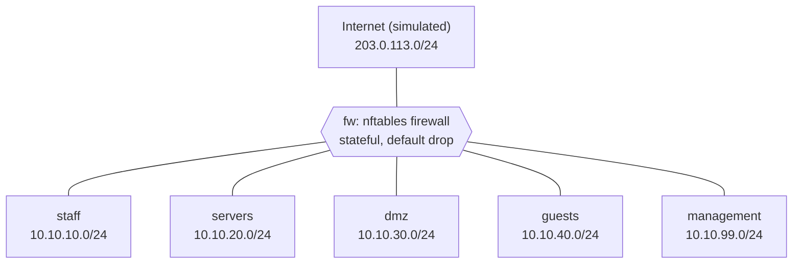

# Network segmentation lab

A small, fully scripted lab that splits a network into five security zones plus a
simulated internet, and enforces who may talk to whom with a stateful nftables
firewall. Everything runs on a single Linux VM using network namespaces: no extra
VMs, no hardware, and it builds in a few seconds.

I built it to understand segmentation by doing it: writing the rules myself and
proving with tests that each one does what I think it does.

## Topology



Every zone is its own network namespace with its own virtual cable (a veth pair)
to the firewall namespace. No zone is connected to another zone, so all traffic
between zones has to pass through the firewall.

## Rules in short

| From | May start connections to |
|---|---|
| staff | servers (SMB 445), dmz (80/443), internet (80/443) |
| servers | nothing |
| dmz | nothing |
| guests | internet (80/443) only |
| management | staff, servers, dmz (SSH + ping), internet (80/443), the firewall (SSH + ping) |
| internet | the DMZ web server, via port forwarding on 203.0.113.1 (80/443) |

The full matrix and the reasoning are in [docs/ip-plan.md](docs/ip-plan.md); the
rules themselves are in [configs/fw.nft](configs/fw.nft).

## Run it

Needs a Linux machine with root access (tested on Ubuntu).

```bash
sudo apt install -y nftables netcat-openbsd iproute2
sudo ./scripts/setup.sh        # build the lab and load the firewall rules
sudo ./tests/run-tests.sh      # run all checks
sudo ./scripts/teardown.sh     # remove everything
```

To try it by hand, run a command inside a zone:

```bash
sudo ip netns exec dmz nc -zv -w 2 10.10.10.10 80   # DMZ -> staff: blocked
```

The lab only exists in memory and is gone after a reboot. `setup.sh` rebuilds it.

## Tests

`tests/run-tests.sh` makes 41 connection attempts between zones (15 that should
work, 26 that should be blocked) and compares the result with what the rule matrix
says. The latest run is in [docs/test-results.md](docs/test-results.md): 41 passed, 0 failed.

Every zone listens on every test port. That way a blocked connection can only be the
firewall's doing, never just "nobody was listening".

## Design decisions

- **Default drop.** The forward chain drops everything that no rule allows.
- **Stateful.** Replies to allowed connections pass automatically, so each rule only
  describes who may start a connection.
- **The DMZ starts nothing inward.** If the web server is compromised, the attacker
  cannot reach staff, servers or management from there.
- **Management is separate.** Admin access (SSH) comes from its own zone and nothing
  can start a connection into it.
- **Outbound is filtered too.** Servers and the DMZ have no internet access, so a
  compromised host cannot call home.
- **Rules match on interface, not only IP.** A packet with a spoofed source address
  arriving on the wrong cable does not match a rule meant for another zone.
- **Port forwarding matches the destination address.** Without that, all web traffic
  from the internet would be redirected to the DMZ, whatever address it was meant for.
- **The firewall protects itself.** The input chain only lets management reach it.
- **Rules load before forwarding is enabled**, so there is never a moment with an
  open network.

## What I learned

The biggest eye-opener was seeing a flat network for myself. Before I had written
any firewall rules, every zone already had its own subnet, and a guest machine could
still ping the management zone without any trouble. Subnets organise a network; it's
the rules between them that actually segment it.

I also got a much better feel for what "stateful" means. Each rule only says who may
start a connection, and connection tracking takes care of the replies. Once that
clicked, the rule matrix became a lot easier to reason about.

Testing turned out to be half the work. A blocked connection proves very little if
nothing was listening on the other side, so every zone runs a listener on every test
port. An earlier version of the port forwarding rule also had a bug: it would have
sent all web traffic from the internet to the DMZ, whatever address it was meant for.
There's now a test that tries to reach internal addresses directly from the internet,
which covers exactly that.

Small details mattered too. "Timed out" means the firewall silently dropped the
packet, while "connection refused" means you reached the host and the port was
closed. Next I want to build the same design on OPNsense with real VLANs and add
logging of dropped traffic.

I built this with step-by-step guidance from Claude, but I ran every command myself
and can explain every rule.

## Limitations and next steps

- Namespaces and virtual cables stand in for real VLANs and switches. Next step: the
  same design on OPNsense with real VLANs.
- Dropped traffic is only counted, not logged. Next step: logging with nflog.
- No rate limiting or connection-tracking tuning, so the firewall is not hardened
  against floods.
- The lab is IPv4 only, with no DNS. The internet is simulated with addresses
  reserved for documentation.
- No intrusion detection. Suricata on the firewall would be a natural addition.
